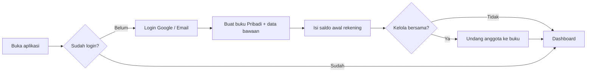
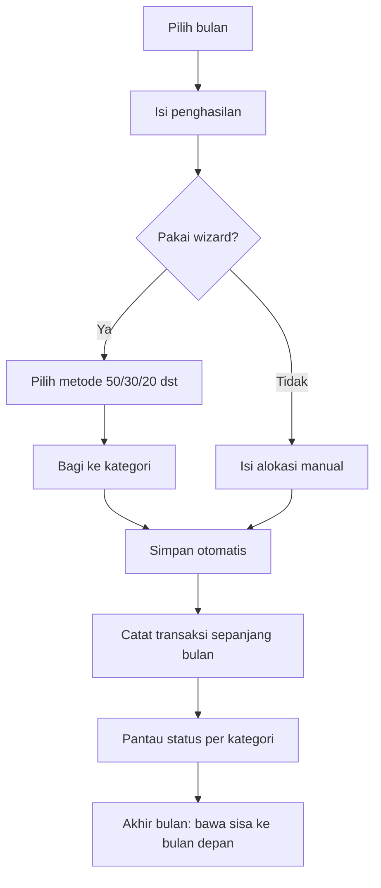
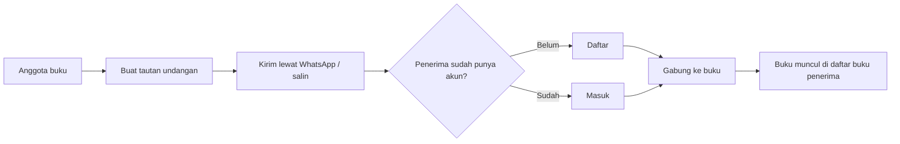

# Business Requirements Document (BRD)
## Vynance — Aplikasi Keuangan Keluarga (Mobile First)

| | |
|---|---|
| Versi | 1.0 (draft) |
| Tanggal | 26 November 2026 |
| Sumber analisa | Repo `fauzanalfi/dompet-keluarga` (React + Firebase), dibaca langsung dari logika kode |
| Ruang lingkup | Proses bisnis, fitur, aturan bisnis, UI/UX. **Teknologi dibahas terpisah.** |
| Desain UI | Folder `design/` (SVG, mobile 390×844) |

---

## 1. Ringkasan

Dompet Keluarga adalah aplikasi pencatat keuangan pribadi untuk keluarga Indonesia. Kode aslinya sudah mencakup banyak fitur: transaksi, rekening, anggaran bulanan, investasi, target tabungan, langganan, zakat, dana pendidikan anak, slip gaji, scan struk, dan AI advisor.

Hasil analisa menunjukkan tiga hal:

1. **Inti produk sudah kuat**: saldo dihitung dari riwayat transaksi, ada skor kesehatan keuangan, dan ada alokasi gaji bulanan dengan *carry-over*.
2. **Nama "Keluarga" belum terwujud**: setiap data terkunci per satu akun Google. Tidak ada fitur berbagi dompet dengan pasangan atau anggota keluarga.
3. **Ada celah logika** yang membuat angka bisa salah (contoh: PayLater dihitung sebagai aset, hapus transaksi investasi tidak mengembalikan nilai aset). Rinciannya ada di bagian 9.

Vynance mengambil inti yang sudah terbukti, memperbaiki celahnya, dan menambahkan **buku bersama** sebagai pembeda utama: satu akun bisa punya beberapa buku (misalnya Pribadi, Keluarga, Warung), dan setiap buku bisa dikelola bersama orang lain yang diundang. Desainnya dibuat *mobile first*: semua alur utama bisa selesai dengan satu tangan.

---

## 2. Latar Belakang & Masalah

| Masalah pengguna | Bukti dari kode / domain |
|---|---|
| Uang keluarga tersebar di banyak tempat (bank, e-wallet, tunai, kartu kredit, PayLater, RDN) | 6 tipe rekening di `WalletView` |
| Gaji habis tanpa tahu ke mana | `SalaryAllocatorView` membandingkan alokasi vs realisasi per kategori |
| Mencatat transaksi itu melelahkan | Ada `QuickAddModal` (scan struk / mutasi via OCR) dan auto-kategori `categorize.js` |
| Biaya rutin (Netflix, internet, asuransi) sering lupa | Langganan membuat transaksi otomatis setiap tanggal bayar |
| Kewajiban keagamaan dan rencana jangka panjang | Kalkulator zakat (nisab 85 g emas) dan dana pendidikan anak (inflasi 12%/tahun) |
| Tidak tahu apakah kondisi keuangan sehat | Skor kesehatan 0–100 dari 4 pilar |

---

## 3. Tujuan Bisnis & Ukuran Keberhasilan

| Kode | Tujuan | Indikator (KPI) | Target awal |
|---|---|---|---|
| BO-1 | Pengguna rutin mencatat | % pengguna aktif mingguan yang mencatat ≥3 transaksi/minggu | ≥ 60% |
| BO-2 | Mencatat cepat | Waktu rata-rata tambah transaksi manual | ≤ 10 detik |
| BO-3 | Anggaran dipakai | % pengguna yang punya anggaran bulan berjalan | ≥ 40% |
| BO-4 | Keluarga ikut bergabung | % buku dengan ≥2 anggota aktif | ≥ 30% |
| BO-5 | Angka bisa dipercaya | Laporan selisih saldo dari pengguna per 1.000 pengguna | < 5 |
| BO-6 | Kebiasaan sehat | Rata-rata kenaikan skor kesehatan setelah 3 bulan | +10 poin |

---

## 4. Pemangku Kepentingan & Persona

### 4.1 Pemangku kepentingan
| Peran | Kepentingan |
|---|---|
| Pemilik produk | Arah fitur, prioritas, monetisasi |
| Tim desain | Alur dan tampilan mobile |
| Tim engineering | Kelayakan teknis (dibahas terpisah) |
| Pengguna akhir | Data akurat, cepat dipakai, privasi terjaga |

### 4.2 Persona
| Persona | Profil | Kebutuhan utama |
|---|---|---|
| **Rina, 34 — Pengelola keuangan keluarga** | Ibu dua anak, pegawai swasta, pegang 2 rekening bank + 2 e-wallet | Anggaran bulanan, catat cepat, dana sekolah anak |
| **Budi, 36 — Pasangan / pencari nafkah** | Dosen (penghasilan aktif + honor + royalti), punya kartu kredit | Lihat sisa anggaran, catat pengeluaran sendiri, slip gaji |
| **Dimas, 27 — Investor pemula** | Lajang, punya RDN dan reksa dana | Pantau portofolio, target tabungan menikah |

> Catatan: kategori penghasilan di kode asli (Gaji Pokok Dosen, Tunjangan Sertifikasi, Honor Penelitian) menunjukkan persona awal adalah keluarga akademisi. Vynance membuatnya lebih umum, dengan kategori bawaan yang bisa diubah.

---

## 5. Ruang Lingkup

### 5.1 Termasuk (MVP + fase lanjut)
- Akun & buku: banyak buku per akun, undang anggota ke buku (baru)
- Rekening (6 tipe) dan saldo berjalan
- Transaksi: pemasukan, pengeluaran, transfer, beli aset, jual aset
- Kategori dan anggaran per kategori
- Rencana bulanan (alokasi gaji) + wizard anggaran + *carry-over*
- Dashboard + skor kesehatan keuangan
- Target tabungan
- Investasi (portofolio + target per jenis aset)
- Langganan & tagihan rutin otomatis
- Scan struk / mutasi (Tambah Cepat)
- AI advisor
- Zakat, dana pendidikan anak, sumber penghasilan, arsip slip gaji
- Ekspor CSV, mode privasi, mode gelap, Bahasa Indonesia / English, multi mata uang untuk langganan

### 5.2 Tidak termasuk
- Koneksi langsung ke API bank (open banking)
- Pembayaran tagihan dari dalam aplikasi
- Saran investasi berlisensi (AI hanya edukatif)
- Pajak (SPT) — kandidat fase berikutnya

---

## 6. Model Data Bisnis (Entitas)

| Entitas | Atribut utama | Catatan aturan |
|---|---|---|
| **Pengguna** | nama, email, foto, bahasa, tema | Login Google; Vynance menambah login email/OTP |
| **Buku** *(baru)* | nama, kode, anggota | Wadah semua data keuangan. Semua entitas di bawah (Rekening s.d. Slip Gaji) milik tepat satu buku. Nama boleh sama, kode selalu beda (BR-47, BR-48) |
| **Anggota Buku** *(baru)* | buku, pengguna, tanggal bergabung | Satu pengguna bisa menjadi anggota banyak buku. Semua anggota punya akses yang sama (BR-49) |
| **Undangan** *(baru)* | buku, tautan, pengundang, kedaluwarsa, status | Status: aktif, dipakai, dibatalkan, kedaluwarsa (BR-50) |
| **Rekening** | nama, tipe, ikon, saldo awal, limit | Tipe: bank, e-wallet, tunai, kartu kredit, PayLater, RDN. Limit hanya untuk tipe utang |
| **Transaksi** | tipe, jumlah, tanggal, rekening, kategori, catatan, sumber | Tipe: `income`, `expense`, `transfer`, `investment`, `investment_sale`. Sumber: manual, langganan otomatis, scan |
| **Kategori** | nama, tipe (masuk/keluar), anggaran bulanan, grup | Grup *(baru)*: Kebutuhan / Keinginan / Tabungan, untuk metode 50/30/20 |
| **Rencana Bulanan** | bulan (YYYY-MM), sumber gaji, plafon pengeluaran, alokasi pengeluaran, alokasi investasi, rekening default | Satu dokumen per bulan |
| **Jenis Investasi** | nama, ikon, target nilai | Contoh bawaan: Emas, Saham Bluechip, Reksa Dana Pasar Uang |
| **Aset Investasi** | nama, jenis, jumlah unit, nilai beli (modal), nilai kini | Untung/rugi = nilai kini − modal |
| **Target Tabungan** | nama, ikon, target, terkumpul, tanggal target, catatan | Vynance menautkan ke rekening atau setoran |
| **Langganan** | nama, biaya (IDR), mata uang asli, biaya asli, siklus, tanggal bayar, rekening, mulai | Siklus bulanan/tahunan |
| **Anak** | nama, tahun lahir, tabungan pendidikan | Untuk rencana dana pendidikan |
| **Sumber Penghasilan** | nama, tipe (aktif/pasif), kategori, nominal/bulan, rutin | + target % penghasilan pasif |
| **Slip Gaji** | file, bulan, tahun, bruto, potongan, neto | Diambil dari PDF |

---

## 7. Proses Bisnis

### PB-01 Onboarding
1. Pengguna masuk (Google / email).
2. Sistem membuat buku pertama bernama **Pribadi** berisi data bawaan: **3 rekening** (Dompet Tunai, Bank, Kartu Kredit limit Rp10 jt), **10 kategori pengeluaran**, **4 kategori pemasukan**, **3 jenis investasi**.
3. *(Vynance)* Pengguna mengisi saldo awal tiap rekening dalam satu layar, lalu memilih: kelola sendiri atau undang anggota ke buku ini.
4. Jika ada data dari mode demo di perangkat, sistem menawarkan impor.

### PB-02 Mencatat Transaksi
1. Pengguna menekan tombol **+** (selalu terlihat di tengah navigasi bawah).
2. Pilih tipe: Keluar (bawaan) / Masuk / Transfer / Beli Aset / Jual Aset.
3. Isi jumlah dengan keypad angka, pilih kategori (chip yang sering dipakai muncul pertama), pilih rekening, tanggal (bawaan: hari ini), catatan opsional.
4. Validasi lalu simpan. Saldo rekening, anggaran, dan dashboard langsung berubah.

**Dampak tiap tipe ke saldo rekening:**

| Tipe | Rekening | Aset investasi | Dihitung di pemasukan/pengeluaran? |
|---|---|---|---|
| Pemasukan | + jumlah | – | Pemasukan |
| Pengeluaran | − jumlah | – | Pengeluaran |
| Transfer | sumber −, tujuan + | – | Tidak |
| Beli Aset | − jumlah | modal +, nilai kini + | Tidak (tercatat sebagai investasi) |
| Jual Aset | + jumlah | modal −, nilai kini − | Tidak |

### PB-03 Tambah Cepat (Scan Struk / Mutasi)
1. Pengguna memotret struk atau tangkapan layar mutasi bank/e-wallet.
2. Sistem membaca teks (OCR), mengenali jenis dokumen (struk, mutasi bank, e-wallet, QRIS), lalu memecah menjadi baris transaksi: tanggal, jumlah, arah (masuk/keluar).
3. Kategori ditebak otomatis dari kata kunci (Indomaret → Belanja Bulanan, Gojek → Transportasi, PLN → Listrik & Air, Netflix → Langganan, dst.).
4. Pengguna meninjau daftar, mengubah/menghapus centang, lalu menyimpan sekaligus.
5. Gambar **tidak disimpan**; dihapus setelah selesai.

### PB-04 Rencana Bulanan (Alokasi Gaji)
1. Pilih bulan.
2. Penghasilan rencana terisi otomatis dari **Sumber Penghasilan** yang rutin (PB-10, BR-52). Pengguna boleh menambah atau mengubah penghasilan khusus bulan itu. Pemasukan yang sudah tercatat tidak dijumlahkan lagi (risiko #8).
   - *(Vynance)* Awal bulan: tombol **Salin rencana bulan lalu** menyalin plafon, rekening default, metode, dan semua alokasi beserta nominal/persennya (BR-53).
3. Isi plafon pengeluaran, pilih rekening default.
4. Tambah alokasi pengeluaran per kategori (nominal atau % dari plafon) dan alokasi investasi (nominal atau % dari total penghasilan).
5. Sistem menyimpan otomatis (jeda 0,6 detik setelah berhenti mengetik).
6. Sistem menampilkan: **sisa belum dialokasikan**, realisasi vs alokasi per kategori dengan status **Aman / Pas / Melebihi / Belum diatur**.
7. Awal bulan: tombol **Bawa sisa bulan lalu** menambahkan sisa tiap kategori (alokasi − realisasi, minimal 0) dan sisa investasi ke bulan ini.

**Wizard Anggaran (5 langkah):** Metode → Pendapatan → Alokasi → Kategori → Simpan.
Preset: **50/30/20**, **60/20/20**, **70/10/20**, atau kustom / nominal tetap. Plafon pengeluaran = Kebutuhan + Keinginan.

### PB-05 Langganan & Tagihan Rutin
1. Pengguna menambah langganan: nama (ikon & warna dikenali otomatis untuk 50+ layanan), biaya, mata uang (IDR/USD/SGD/EUR/MYR/JPY/AUD, kurs bisa diambil otomatis), siklus, tanggal bayar, rekening.
2. *(Vynance, mengganti tagihan otomatis)* Setiap bulan tagihan, langganan muncul sebagai **rencana transaksi** (PB-13) dengan kategori pilihan pengguna (bawaan **Langganan**). Saldo tidak berubah sampai pengguna menekan **Realisasi**.
3. Tanggal bayar 31 di bulan pendek otomatis menjadi tanggal terakhir bulan itu.
4. *(Vynance)* Pengingat H-3 sebelum tanggal bayar dan dukungan siklus tahunan.

### PB-06 Investasi
1. Pengguna membuat jenis investasi dengan target nilai (mis. Emas target Rp100 jt).
2. Menambah aset: nama, jenis, unit, modal, nilai kini. Jika rekening sumber dipilih, sistem membuat transaksi **Beli Aset** yang mengurangi saldo rekening.
3. Top-up dan penjualan dicatat lewat transaksi Beli/Jual Aset. Penjualan ditolak jika melebihi nilai aset.
4. Nilai kini diperbarui manual. Sistem menampilkan total modal, total nilai, untung/rugi (Rp & %), dan progres tiap jenis terhadap target.

### PB-07 Target Tabungan
1. Buat target: nama, ikon, nominal target, sudah terkumpul, tanggal target.
2. Sistem menghitung: persentase, sisa, sisa bulan, setoran per bulan yang dibutuhkan.
3. Status: **Tercapai** (≥100%), **Lewat tenggat** (tanggal lewat), **Sesuai jalur**, **Perlu perhatian** (aturan baru di 8.4).

### PB-08 Zakat Maal
1. Sistem mengambil harga emas per gram (live → cache → nilai bawaan), atau pengguna mengisi manual.
2. Nisab = 85 gram × harga emas.
3. Harta = saldo semua rekening non-utang + nilai investasi. *(Vynance: dikurangi utang jatuh tempo.)*
4. Jika harta ≥ nisab, zakat = 2,5% × harta. Tombol **Catat pembayaran** membuat transaksi kategori Zakat & Infaq.

### PB-09 Dana Pendidikan Anak
1. Tambah anak: nama, tahun lahir, tabungan pendidikan saat ini.
2. Sistem menyusun rencana per jenjang dengan biaya dasar hari ini: TK (umur 4, Rp5 jt), SD (6, Rp15 jt), SMP (12, Rp25 jt), SMA (15, Rp35 jt), Kuliah (18, Rp150 jt).
3. Biaya masa depan = biaya dasar × (1 + 12%)^tahun menuju jenjang.
4. Setoran per bulan = (biaya masa depan − tabungan) ÷ bulan tersisa.
5. Status per jenjang: Akan datang / Sedang berjalan / Selesai.

### PB-10 Sumber Penghasilan & Slip Gaji
- Catat sumber penghasilan aktif dan pasif per bulan. Sistem menghitung porsi pasif dan membandingkannya dengan target (bawaan 30%).
- Unggah slip gaji PDF. Sistem membaca periode, penghasilan kotor, potongan, dan penghasilan bersih, lalu menampilkan tren 12 bulan dan % perubahan.

### PB-13 Rencana Transaksi & Realisasi *(baru di Vynance)*
1. Setiap bulan sistem menyiapkan **rencana transaksi** dari (a) sumber penghasilan yang rutin, nominal per bulan, dan (b) langganan aktif yang ditagih bulan itu. Rencana tidak dibuat dua kali untuk sumber dan bulan yang sama (BR-50).
2. Rencana tampil di daftar transaksi dengan tanda **Rencana** dan tidak memengaruhi saldo, realisasi anggaran, skor, maupun Beranda (BR-51).
3. Aksi **Realisasi** membuka form berisi nominal, tanggal, rekening, dan kategori dari rencana. Semuanya bisa diubah. Nominal boleh berbeda dari rencana.
4. Nominal **0** berarti **Lewati**: tidak ada transaksi, rencana ditandai dilewati untuk bulan itu.
5. Realisasi bisa dibatalkan dengan menghapus transaksinya; rencana kembali ke status belum direalisasi.
6. Rencana bulan yang sudah lewat dan belum direalisasi tetap tampil sebagai **Terlewat** sampai direalisasi atau dilewati.

### PB-14 Daftar Transaksi: Dua Mode *(baru di Vynance)*
- **Riwayat** (bawaan, seperti sekarang): transaksi terealisasi urut tanggal, terbaru di atas. Rencana bulan ini tampil di bagian **Rencana** di atas daftar.
- **Per kategori**: transaksi bulan terpilih dikelompokkan per kategori. Tiap kelompok menampilkan **pagu** (alokasi rencana bulanan), **realisasi** (BR-10), dan **rencana belum direalisasi** (penghasilan dan langganan yang belum direalisasi), lalu daftar transaksinya. Kategori tanpa transaksi tetapi punya pagu atau rencana tetap tampil.

### PB-11 AI Advisor
1. Sistem merangkum kondisi keuangan: aset bersih, kas, investasi, utang kartu kredit, pemasukan & pengeluaran bulan ini, 5 kategori pengeluaran terbesar, skor kesehatan, target tabungan, 5 aset teratas.
2. Pengguna bertanya bebas atau memilih pertanyaan cepat.
3. AI menjawab dalam Bahasa Indonesia, memakai angka pengguna, maksimal ±300 kata.
4. Data ringkasan dikirim ke penyedia AI hanya setelah pengguna setuju.

### PB-12 Buku & Anggota *(baru di Vynance)*
1. Setiap akun punya minimal satu buku sejak daftar (PB-01). Pengguna bisa membuat buku lain kapan saja, misalnya untuk keluarga, usaha, atau arisan. Buku baru diisi data bawaan yang sama dengan PB-01.
2. Pengguna memilih **buku aktif** dari Beranda. Semua layar hanya menampilkan data buku aktif. Saldo, anggaran, dan laporan tidak digabung lintas buku.
3. Anggota mana pun bisa mengundang orang lain lewat tautan undangan. Penerima masuk atau daftar, lalu menjadi anggota buku itu.
4. **Semua anggota punya akses yang sama**: melihat dan mengubah semua data buku, mengundang, mengeluarkan anggota lain, keluar dari buku, dan menghapus buku.
5. Setiap transaksi dan perubahan mencatat siapa yang melakukannya, dan tampil di aktivitas buku.
6. Anggaran bulanan berlaku untuk buku. Notifikasi dikirim ke semua anggota saat kategori mencapai 90%.

---

## 8. Aturan Bisnis & Rumus

### 8.1 Saldo & kekayaan
| ID | Aturan |
|---|---|
| BR-01 | Saldo rekening = saldo awal + Σ efek transaksi (tabel PB-02). Saldo tidak disimpan, selalu dihitung. |
| BR-02 | Kas likuid = Σ saldo rekening **non-utang** (bank, e-wallet, tunai, RDN). |
| BR-03 | Utang = Σ saldo rekening **kartu kredit dan PayLater** (nilai negatif). *Perbaikan: kode asli hanya menghitung kartu kredit.* |
| BR-04 | Kekayaan bersih = kas likuid + nilai kini investasi − utang. |
| BR-05 | Pemakaian limit = \|saldo utang\| ÷ limit × 100%. |

### 8.2 Skor Kesehatan Keuangan (0–100, 4 pilar × 25 poin)
| Pilar | Rumus | Penuh jika |
|---|---|---|
| Tingkat tabungan | (masuk − keluar) ÷ masuk bulan ini; poin = min(25, rate ÷ 20% × 25) | ≥ 20% |
| Disiplin anggaran | kategori dalam anggaran ÷ kategori beranggaran × 25 | Semua dalam anggaran |
| Rasio utang | pemakaian ≤30% → 25; ≥90% → 0; di antaranya linear | ≤ 30% |
| Porsi investasi | investasi ÷ (kas + investasi); poin = min(25, ratio ÷ 20% × 25) | ≥ 20% |

Label: **≥80 Sangat Baik**, **≥60 Baik**, **≥40 Cukup**, **<40 Perlu Perhatian**.
*Perbaikan Vynance:* pilar tanpa data (belum ada anggaran / belum ada kartu kredit) ditandai "belum dinilai" dan skor dihitung ulang secara proporsional, bukan otomatis 25 poin.

### 8.3 Anggaran
| ID | Aturan |
|---|---|
| BR-10 | Realisasi kategori = Σ pengeluaran kategori itu di bulan berjalan. |
| BR-11 | Peringatan saat realisasi ≥ 90% anggaran; merah saat > 100%. |
| BR-12 | Status alokasi: alokasi 0 → Belum diatur; realisasi > alokasi → Melebihi; sama → Pas; selain itu Aman. |
| BR-13 | Sisa belum dialokasikan = total penghasilan − (alokasi pengeluaran + alokasi investasi). |
| BR-14 | Carry-over: sisa kategori = max(alokasi − realisasi, 0); digabung ke kategori yang sama bulan ini. |

### 8.4 Target tabungan
| ID | Aturan |
|---|---|
| BR-20 | Setoran/bulan = sisa ÷ sisa bulan (jika sisa bulan > 0). |
| BR-21 | *Perbaikan:* "Perlu perhatian" hanya jika laju setoran 3 bulan terakhir < setoran/bulan yang dibutuhkan. Di kode asli, semua target bertanggal yang belum lunas otomatis "berisiko". |

### 8.5 Validasi transaksi
| ID | Aturan |
|---|---|
| BR-30 | Jumlah > 0. |
| BR-31 | Transfer: rekening sumber ≠ tujuan. |
| BR-32 | Beli/Jual aset wajib memilih rekening dan aset. |
| BR-33 | Jual aset ≤ nilai kini dan ≤ modal aset. |
| BR-34 | *Perbaikan:* hapus/ubah transaksi Beli/Jual Aset ikut membalik dampaknya ke aset. |
| BR-35 | *Perbaikan:* rekening yang masih punya transaksi tidak dihapus permanen, tetapi diarsipkan. |
| BR-36 | *Perbaikan:* kategori disimpan dengan ID, sehingga mengganti nama kategori tidak memutus riwayat dan anggaran. |

### 8.6 Lain-lain
| ID | Aturan |
|---|---|
| BR-40 | Total langganan per bulan = Σ (bulanan: biaya; tahunan: biaya ÷ 12). |
| BR-41 | Rencana langganan dibuat maksimal satu kali per langganan per bulan. |
| BR-42 | Zakat = 2,5% × harta jika harta ≥ 85 g × harga emas. |
| BR-43 | Inflasi pendidikan bawaan 12%/tahun, bisa diubah pengguna. |
| BR-44 | Mode privasi mengganti semua nominal menjadi "Rp ••••••". |
| BR-50 | Rencana transaksi unik per (sumber: penghasilan/langganan, id sumber, bulan). Status: Belum, Direalisasi, Dilewati. |
| BR-51 | Rencana belum direalisasi tidak dihitung di saldo, realisasi anggaran, skor, dan Beranda. |
| BR-52 | Penghasilan rencana bulanan = Σ nominal sumber penghasilan rutin + penghasilan khusus bulan itu. |
| BR-53 | Salin rencana bulan lalu menimpa alokasi bulan ini hanya setelah pengguna setuju bila bulan ini sudah berisi. |
| BR-54 | Rencana per kategori (PB-14) = Σ rencana belum direalisasi bulan itu yang kategorinya sama. |

### 8.7 Buku & anggota
| ID | Aturan |
|---|---|
| BR-45 | Setiap data keuangan (rekening, transaksi, kategori, anggaran, target, investasi, langganan, dan lainnya) milik tepat satu buku. Transfer hanya boleh antar rekening dalam buku yang sama. |
| BR-46 | Saat daftar, sistem membuat satu buku bernama "Pribadi" dengan data bawaan PB-01. Setiap buku baru juga diisi data bawaan. |
| BR-47 | Nama buku wajib, 1–40 karakter, dan **boleh sama** dengan buku lain, termasuk buku lain milik akun yang sama. |
| BR-48 | **Kode buku** dibuat sistem saat buku dibuat: 8 karakter huruf besar dan angka tanpa huruf yang mirip angka (I, L, O, U), ditampilkan `XXXX-XXXX`. Kode unik di seluruh Vynance, tidak bisa diubah, dan tidak dipakai ulang setelah buku dihapus. Kode ditampilkan di samping nama buku supaya buku bernama sama bisa dibedakan. Mengetahui kode **tidak** memberi akses ke buku. |
| BR-49 | Semua anggota buku punya hak yang sama. Tidak ada peran. |
| BR-50 | Tautan undangan berisi token acak, berlaku 7 hari, sekali pakai, dan bisa dibatalkan anggota mana pun. Pengguna yang sudah menjadi anggota tidak bisa diundang lagi. |
| BR-51 | Buku selalu punya minimal satu anggota. Anggota terakhir tidak bisa keluar; ia harus menghapus buku. |
| BR-52 | Menghapus buku wajib dikonfirmasi dengan mengetik nama buku. Buku dan seluruh datanya disembunyikan dari semua anggota, bisa dipulihkan anggotanya selama 30 hari, lalu dihapus permanen. |
| BR-53 | Anggota yang dikeluarkan atau keluar langsung kehilangan akses ke buku. Data yang pernah ia catat tetap ada dan tetap mencatat namanya sebagai pembuat. |
| BR-54 | Bila pengguna tidak punya buku lagi (keluar dari buku terakhir), aplikasi memintanya membuat buku baru sebelum masuk ke Beranda. |

---

## 9. Temuan Analisa Kode (Celah yang Diperbaiki)

| # | Temuan | Dampak | Keputusan Vynance |
|---|---|---|---|
| 1 | Tidak ada fitur berbagi keluarga; data per satu akun | Pasangan tidak bisa mencatat bersama | Tambah Buku bersama dan banyak buku per akun (PB-12) |
| 2 | PayLater dihitung sebagai kas likuid | Kekayaan bersih terlalu tinggi | BR-03 |
| 3 | Hapus transaksi Beli/Jual Aset tidak membalik nilai aset; edit dinonaktifkan | Portofolio tidak cocok dengan riwayat | BR-34 |
| 4 | Hapus rekening meninggalkan transaksi "Terhapus" | Saldo total berubah tanpa jejak | BR-35 (arsip) |
| 5 | Kategori disimpan sebagai nama | Ganti nama memutus anggaran | BR-36 |
| 6 | Status target tabungan hampir selalu "berisiko" | Pesan menakutkan tanpa alasan | BR-21 |
| 7 | Skor kesehatan memberi 25 poin penuh untuk pilar tanpa data | Skor tampak lebih baik dari kenyataan | 8.2 |
| 8 | Rencana bulanan menjumlahkan gaji manual + pemasukan tercatat | Penghasilan bisa terhitung dua kali | Pilih salah satu sumber: "rencana" vs "realisasi" ditampilkan terpisah |
| 9 | Dana pendidikan memakai tabungan yang sama untuk tiap jenjang | Kebutuhan setoran terlalu rendah | Tabungan dibagi berurutan per jenjang |
| 10 | Langganan otomatis hanya siklus bulanan; tidak ada pengingat | Tagihan tahunan terlewat | PB-05 langkah 4 |
| 11 | Zakat tidak memperhitungkan utang & haul | Nominal zakat kurang tepat | PB-08 langkah 3 + pengingat haul |
| 12 | Kunci API OCR disimpan di database pengguna; kunci AI di perangkat | Pengguna awam harus punya kunci API sendiri | Fitur AI & OCR disediakan oleh layanan Vynance (dibahas di sesi teknologi) |
| 13 | Banyak `alert()` / `confirm()` bawaan browser | Pengalaman mobile kasar | Snackbar + bottom sheet konfirmasi + tombol Urungkan |
| 14 | Pemasukan/pengeluaran di ringkasan memakai total sepanjang waktu | Angka dashboard membingungkan | Ringkasan selalu per periode yang dipilih |

---

## 10. Kebutuhan Fungsional

Prioritas: **M** = Must (MVP), **S** = Should, **C** = Could.

| ID | Modul | Kebutuhan | Prioritas |
|---|---|---|---|
| FR-01 | Akun | Login Google dan email/OTP; logout | M |
| FR-02 | Akun | Data bawaan saat pertama kali masuk | M |
| FR-03 | Buku | Buat, ganti buku aktif, ubah nama, hapus dan pulihkan buku; kode buku unik | M |
| FR-04 | Buku | Undang lewat tautan, batalkan undangan, lihat dan keluarkan anggota, keluar dari buku, aktivitas buku | S |
| FR-10 | Rekening | CRUD rekening 6 tipe, saldo awal, limit utang, ikon | M |
| FR-11 | Rekening | Detail rekening + riwayat transaksinya | M |
| FR-12 | Rekening | Arsip rekening | S |
| FR-20 | Transaksi | Tambah/ubah/hapus 5 tipe transaksi | M |
| FR-21 | Transaksi | Filter tipe, rentang tanggal, rekening; cari catatan | M |
| FR-22 | Transaksi | Ekspor CSV (kompatibel Excel) | S |
| FR-23 | Transaksi | Tandai sumber: manual / otomatis / scan | M |
| FR-24 | Transaksi | Urungkan setelah hapus (5 detik) | S |
| FR-30 | Kategori | CRUD kategori, anggaran bulanan, grup 50/30/20 | M |
| FR-40 | Anggaran | Rencana bulanan per bulan, simpan otomatis | M |
| FR-41 | Anggaran | Wizard 5 langkah dengan preset | S |
| FR-42 | Anggaran | Bawa sisa bulan lalu | S |
| FR-43 | Anggaran | Peringatan 90% dan lewat anggaran | M |
| FR-50 | Dashboard | Kekayaan bersih, kas, investasi, utang | M |
| FR-51 | Dashboard | Skor kesehatan + rincian 4 pilar | M |
| FR-52 | Dashboard | Arus kas 6 bulan, pengeluaran per kategori, bulan ini vs bulan lalu | S |
| FR-53 | Dashboard | Transaksi terakhir, progres anggaran teratas | M |
| FR-60 | Target | CRUD target tabungan, setoran, status | M |
| FR-70 | Investasi | Jenis + target, aset, untung/rugi, beli/jual | S |
| FR-80 | Langganan | CRUD, multi mata uang, transaksi otomatis, pengingat | S |
| FR-90 | Tambah Cepat | Scan struk/mutasi, tinjau, simpan sekaligus | S |
| FR-100 | AI | Tanya jawab berdasar ringkasan data, pertanyaan cepat | C |
| FR-110 | Zakat | Hitung zakat maal + catat pembayaran | S |
| FR-120 | Pendidikan | Rencana dana pendidikan per anak | C |
| FR-130 | Penghasilan | Sumber aktif/pasif + target pasif | C |
| FR-140 | Slip gaji | Unggah PDF, ekstrak, tren 12 bulan | C |
| FR-150 | Umum | Mode privasi, mode gelap, ID/EN, tarik untuk muat ulang | M |
| FR-151 | Umum | Impor data lama / mode demo | C |
| FR-160 | Rencana | Rencana transaksi dari penghasilan dan langganan, aksi Realisasi/Lewati | S |
| FR-161 | Langganan | Pilih kategori langganan, bisa diubah saat realisasi | S |
| FR-162 | Transaksi | Mode Riwayat dan Per kategori (pagu, realisasi, rencana) | S |
| FR-163 | Anggaran | Penghasilan otomatis dari sumber + salin rencana bulan lalu | S |

---

## 11. Kebutuhan Non-Fungsional (tingkat bisnis)

| ID | Kebutuhan |
|---|---|
| NFR-01 | Data sebuah buku hanya bisa dibaca dan diubah oleh anggota buku itu. Tidak ada data yang bocor antar buku. |
| NFR-02 | Gambar struk dan PDF slip gaji tidak disimpan setelah diproses (kecuali pengguna memilih arsip). |
| NFR-03 | Perubahan tampil di perangkat anggota lain buku yang sama dalam ≤ 3 detik. |
| NFR-04 | Pencatatan tetap bisa dilakukan saat offline dan tersinkron saat online. |
| NFR-05 | Layar utama tampil ≤ 2 detik di HP kelas menengah dengan jaringan 4G. |
| NFR-06 | Aksesibilitas WCAG 2.2 AA: kontras ≥ 4.5:1, target sentuh ≥ 44 px, dukung ukuran teks besar. |
| NFR-07 | Format Rupiah `Rp1.250.000` (locale id-ID), tanggal `26 Nov 2026`. |
| NFR-08 | Ekspor & hapus semua data atas permintaan pengguna (UU PDP). |

---

## 12. Kebutuhan UI/UX (Mobile First)

### 12.1 Prinsip
1. **Satu tangan**: aksi utama (tambah transaksi) berada di zona jempol, di tengah navigasi bawah.
2. **Angka dulu, grafik kemudian**: setiap layar dibuka dengan satu angka yang paling penting.
3. **Warna punya arti tetap**: hijau = masuk, merah bata = keluar, biru = transfer, emas = investasi.
4. **Bahasa sederhana**: "Sisa anggaran" bukan "variance", "Uang masuk" bukan "income".
5. **Tidak ada dialog browser**: konfirmasi lewat bottom sheet, hasil lewat snackbar dengan Urungkan.

### 12.2 Arsitektur informasi
Navigasi bawah 5 slot: **Beranda · Transaksi · [ + ] · Anggaran · Lainnya**

- **Beranda**: kekayaan bersih, ringkasan bulan, skor kesehatan, anggaran teratas, transaksi terakhir.
- **Transaksi**: daftar per tanggal, filter chip, cari, ekspor.
- **+**: bottom sheet tambah transaksi; tekan lama → Scan struk.
- **Anggaran**: rencana bulanan, status per kategori, wizard, carry-over.
- **Lainnya**: Rekening, Target Tabungan, Investasi, Langganan, Zakat, Dana Pendidikan, Sumber Penghasilan, Slip Gaji, Kategori, Buku, Pengaturan, AI Advisor.

### 12.3 Daftar layar (SVG di folder `design/`)
| File | Layar |
|---|---|
| `00-design-system.svg` | Warna, tipografi, komponen |
| `01-sitemap-flow.svg` | Peta layar & alur utama |
| `02a-login.svg` | Masuk |
| `02b-onboarding.svg` | Onboarding: isi saldo awal |
| `03-dashboard.svg` | Beranda |
| `04-add-transaction.svg` | Bottom sheet tambah transaksi |
| `05-transactions.svg` | Daftar transaksi |
| `06-wallets.svg` | Rekening & utang |
| `07-budget.svg` | Rencana bulanan |
| `08-budget-wizard.svg` | Wizard anggaran |
| `09-savings-goals.svg` | Target tabungan |
| `10-investments.svg` | Portofolio |
| `11-subscriptions.svg` | Langganan |
| `12-quick-add-scan.svg` | Tinjau hasil scan |
| `13-ai-advisor.svg` | AI advisor |
| `14-more-menu.svg` | Menu Lainnya |
| `15-zakat.svg` | Kalkulator zakat |
| `16-education-fund.svg` | Dana pendidikan |
| `17-books.svg` | Buku & anggota: buku aktif, anggota, buku lain, buat buku |
| `vynance-board.svg` | Semua layar dalam satu papan |

### 12.5 Alternatif tema warna
Layout dan komponennya sama di semua tema. Yang berbeda hanya token warna dan jenis huruf (`design/_source/themes.py`). Perbandingan lengkapnya ada di `design/tema-perbandingan.svg`. Setiap tema punya set 17 layar sendiri di `design/themes/<tema>/`.

| Tema | Karakter | Primer | Huruf |
|---|---|---|---|
| Hutan (awal) | Tenang, terpercaya | Hijau hutan + emas | Plus Jakarta Sans |
| Samudra | Profesional, mirip aplikasi bank | Biru laut + oranye senja | Manrope |
| Terakota | Hangat, kekeluargaan | Bata + krem + zaitun | DM Sans |
| Anggrek | Modern, ramah anak muda | Ungu plum + mint | Outfit |
| Malam | Mode gelap, nyaman malam hari | Arang + mint + emas | Plus Jakarta Sans |
| Citrus | Tegas, gaya fintech baru | Hitam + hijau limau | Space Grotesk |

Pemilihan tema rilis memakai rubrik penilaian desain (`docs/design-system/DESIGN-DECISION-RUBRIC.md`). Hasil ukur kontras per tema ada di `docs/THEME-CONTRAST.md`. Per 27 November 2026, keenam tema lolos semua pasangan kontras setelah token diperbaiki, jadi pemilihan tema rilis bisa lanjut ke penilaian rubrik.

Di semua tema, warna yang punya arti tetap sama: hijau untuk uang masuk, merah untuk uang keluar, biru untuk transfer, dan kuning tua untuk investasi. Pengecualiannya: di Samudra, transfer memakai ungu-biru supaya tidak tertukar dengan warna primer.

Sumber generator SVG: `design/_source/gen_svg.py` (token warna, ikon, dan komponen ada di satu file; jalankan `python gen_svg.py <folder-output>` untuk membuat ulang).

### 12.4 Status kosong, memuat, dan galat
| Situasi | Perilaku |
|---|---|
| Belum ada transaksi | Ilustrasi kecil + "Catat transaksi pertamamu" + tombol |
| Memuat | Kerangka (skeleton) seukuran kartu |
| Gagal simpan | Snackbar merah + "Coba lagi"; data form tidak hilang |
| Offline | Pita kecil "Offline — akan disinkronkan" |

---

## 13. Asumsi, Ketergantungan, Risiko

| Jenis | Isi |
|---|---|
| Asumsi | Pengguna mau mencatat manual; scan hanya mempercepat |
| Asumsi | Mata uang utama IDR; mata uang lain hanya untuk langganan |
| Ketergantungan | Sumber harga emas & kurs (pihak ketiga) |
| Ketergantungan | Layanan OCR dan AI (pihak ketiga) |
| Risiko | Akurasi OCR mutasi bank bervariasi per bank → wajib layar tinjau |
| Risiko | AI memberi saran keliru → label "edukasi, bukan nasihat keuangan berlisensi" |
| Risiko | Konflik edit antar anggota keluarga → catat pembuat & waktu, perubahan terakhir menang |

---

## 14. Rencana Rilis

| Fase | Isi |
|---|---|
| **MVP** | Akun, buku (banyak buku per akun, ganti buku aktif), rekening, transaksi 5 tipe, kategori + anggaran, rencana bulanan, dashboard + skor, target tabungan, mode privasi/gelap, ekspor CSV |
| **Fase 2** | Undang anggota ke buku, langganan + pengingat, investasi, scan struk, wizard & carry-over, zakat |
| **Fase 3** | AI advisor, dana pendidikan, sumber penghasilan, slip gaji, offline penuh |
| **Fase 4** | Rencana transaksi & realisasi, kategori langganan, daftar transaksi per kategori, penghasilan otomatis di anggaran |

---

## 15. Glosarium

| Istilah | Arti |
|---|---|
| Buku | Wadah semua data keuangan, misalnya "Pribadi", "Keluarga Pratama", "Warung". Satu akun bisa punya banyak buku dan berbagi buku dengan anggota lain |
| Kode buku | Kode 8 karakter (`K7QM-3XPA`) yang membedakan buku bernama sama |
| Anggota | Pengguna yang tergabung di sebuah buku. Semua anggota punya hak yang sama |
| Rekening / Kantong | Tempat uang: bank, e-wallet, tunai, kartu kredit, PayLater, RDN |
| RDN | Rekening Dana Nasabah untuk transaksi saham |
| Carry-over | Membawa sisa anggaran bulan lalu ke bulan ini |
| Nisab | Batas minimal harta wajib zakat (85 g emas) |
| Haul | Harta dimiliki selama 1 tahun hijriah |
| Skor kesehatan | Nilai 0–100 kondisi keuangan dari 4 pilar |
