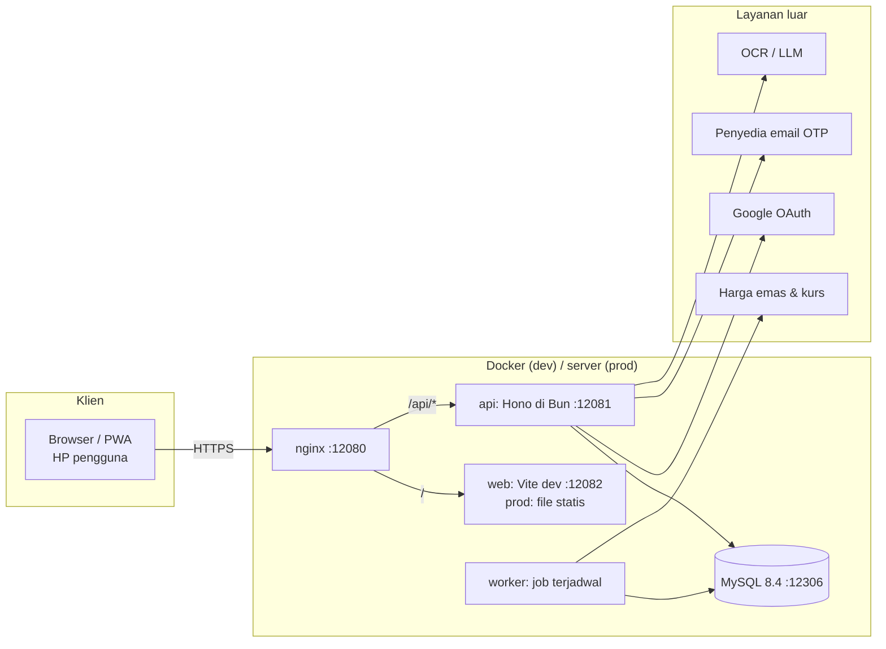

# Technical Specification Document (TSD)
## Vynance — Aplikasi Keuangan Keluarga (Mobile First)

| Item | Isi |
|---|---|
| Versi | 1.0 (draf) |
| Tanggal | 27 November 2026 |
| Dasar | [BRD-Vynance.md](BRD-Vynance.md) |
| Aturan kode | [CODING-GUIDELINES.md](CODING-GUIDELINES.md) |
| Aturan UI | [DESIGN-SYSTEM.md](DESIGN-SYSTEM.md) |
| Keputusan arsitektur | [ADR 0002](adr/0002-monorepo-stack-and-layering.md) |

Dokumen ini menjelaskan **bagaimana** BRD dibangun: arsitektur, lingkungan, model data (ERD), API, keamanan, pekerjaan latar, dan rencana teknis per fase. Aturan cara menulis kode tidak diulang di sini; rujukannya ada di CODING-GUIDELINES.

---

## 1. Ringkasan teknis

- Aplikasi web *mobile first* (PWA) dengan satu origin: nginx meneruskan `/api/*` ke backend dan sisanya ke frontend.
- Monorepo Bun: `apps/api` (Hono), `apps/web` (Vite + React + TanStack), `apps/worker` (job terjadwal, Fase 2), `packages/shared` (tipe, skema Zod, aturan bisnis), `packages/db` (skema Drizzle + migrasi), `packages/ui` (token tema).
- MySQL 8.4. Uang disimpan `BIGINT` rupiah utuh. Semua data keuangan terikat ke satu **buku** lewat `book_id`.
- Autentikasi Better Auth (Google + email OTP) dengan cookie sesi `httpOnly`.

---

## 2. Arsitektur



| Komponen | Tanggung jawab |
|---|---|
| nginx | Satu pintu masuk. Meneruskan `/api/*` ke api dan sisanya ke web. Mendukung WebSocket (HMR Vite) dan SSE (`proxy_buffering off`). |
| web | SPA React. Di produksi dibangun menjadi file statis yang dilayani nginx. |
| api | REST + Hono RPC. Lapisan route → service → repository (CODING-GUIDELINES §3.1). |
| worker | Langganan otomatis, pengingat, hapus permanen buku, pembaruan harga emas dan kurs. Memakai service dari `apps/api`. |
| MySQL | Satu-satunya penyimpanan data. Zona waktu server UTC. |

---

## 3. Lingkungan dan port

### 3.1 Development (Docker Compose)

| Layanan | Container | Port host → container | Keterangan |
|---|---|---|---|
| nginx | `vynance-nginx` | **12080** → 12080 | Pintu masuk utama: `http://localhost:12080` |
| backend | `vynance-api` | **12081** → 12081 | `GET /api/v1/health` |
| frontend | `vynance-web` | **12082** → 12082 | Vite dev server, HMR |
| database | `vynance-db` | **12306** → 3306 | MySQL 8.4, user `vynance`, DB `vynance` |
| install | `vynance-install` | – | Sekali jalan: `bun install` ke volume `node-modules` |

Perintah:

```bash
bun run dev        # docker compose up -d --build
bun run dev:logs   # ikuti log
bun run dev:down   # hentikan
bun run db:migrate # jalankan migrasi Drizzle ke localhost:12306
```

Catatan teknis:

- Kode di-*mount* dari host. `node_modules` Linux disimpan di volume `node-modules` terpisah dari `node_modules` Windows di host, dan `bunfig.toml` memakai linker `hoisted` supaya cukup satu volume.
- Bind mount dari Windows tidak mengirim event perubahan file ke container. Vite memakai polling (`VITE_POLL=1`). `bun --watch` di api mungkin tidak mendeteksi perubahan; jalankan `docker compose restart api` bila perlu.
- Nilai bawaan kata sandi DB hanya untuk development dan bisa diganti lewat `.env` (lihat `.env.example`).

### 3.2 Produksi (rencana)

- Image api dan worker dibangun dari `oven/bun`, web dibangun menjadi file statis dan disajikan nginx.
- HTTPS di nginx atau load balancer. Cookie `Secure`, `SameSite=Lax`.
- MySQL terkelola dengan backup harian dan uji pemulihan bulanan.
- Rahasia lewat variabel lingkungan server, tidak pernah di image atau repo.

### 3.3 Variabel lingkungan

| Variabel | Dipakai | Contoh |
|---|---|---|
| `DATABASE_URL` | api, worker, drizzle-kit | `mysql://vynance:***@db:3306/vynance` |
| `PORT` | api | `12081` |
| `NODE_ENV` | api, worker | `development` |
| `AUTH_SECRET` | api (Better Auth) | 32+ karakter acak |
| `APP_URL` | api (tautan undangan, callback OAuth) | `http://localhost:12080` |
| `GOOGLE_CLIENT_ID`, `GOOGLE_CLIENT_SECRET` | api | dari Google Cloud Console |
| `EMAIL_FROM`, `EMAIL_API_KEY` | api (OTP) | penyedia email transaksional |
| `OCR_API_KEY`, `LLM_API_KEY` | api (Fase 2–3) | kunci layanan Vynance, bukan milik pengguna |
| `API_PROXY_TARGET`, `VITE_POLL` | web dev | `http://api:12081`, `1` |

Semua variabel dibaca hanya di `apps/api/src/config/env.ts` dan divalidasi Zod saat start (CODING-GUIDELINES §11).

---

## 4. Struktur kode

Struktur folder dan aturan lapisan ada di CODING-GUIDELINES §2–§3. Tambahan khusus TSD:

```
apps/api/src/
├─ index.ts            titik masuk: createApp(container) + Bun.serve
├─ app.ts              createApp(): rangkaian route, export AppType untuk Hono RPC
├─ container.ts        composition root
├─ config/env.ts       validasi env
├─ db/                 client.ts, unit-of-work.ts (withTransaction)
├─ middleware/         auth.ts, book-access.ts, idempotency.ts, error-handler.ts
├─ lib/                errors.ts, respond.ts (ok, created, page)
└─ modules/<fitur>/    route, service, repository, mapper, test
```

---

## 5. Autentikasi dan buku (multi-tenant)

### 5.1 Autentikasi

- **Better Auth** dengan penyedia Google dan email OTP (FR-01). Tabel Better Auth: `users`, `sessions`, `accounts`, `verifications`.
- Sesi disimpan di DB dan dikirim sebagai cookie `httpOnly`. Karena web dan api satu origin lewat nginx, tidak perlu CORS.
- Logout menghapus sesi di DB.

### 5.2 Buku sebagai tenant

- Setiap tabel data keuangan punya `book_id` (BR-45). Tabel global hanya: tabel auth, `books`, `book_members`, `book_invitations`, dan `reference_rates`.
- URL data selalu berbentuk `/api/v1/books/:bookId/<resource>`.
- Middleware `bookAccess` mencari baris `book_members` aktif untuk `(bookId, userId)`. Bila tidak ada, atau buku sudah dihapus, respons **404** supaya keberadaan buku tidak bocor. Bila ada, `ServiceCtx = { userId, bookId }` dipasang di `c.var.ctx`.
- Repository wajib memfilter `book_id` di setiap query (CODING-GUIDELINES §6.4). Test repository wajib membuktikan data buku lain tidak ikut terbaca.
- Tidak ada peran (BR-49). Semua anggota boleh semua aksi di bukunya.

### 5.3 Kode buku (BR-48)

- 8 karakter dari alfabet Crockford Base32 tanpa I, L, O, U: `0123456789ABCDEFGHJKMNPQRSTVWXYZ`. Ruangnya 32⁸ ≈ 1,1 × 10¹².
- Dibuat dengan `crypto.getRandomValues` di service (bukan di `shared`, karena `shared` deterministik), disimpan tanpa tanda hubung di kolom `books.code CHAR(8)` dengan indeks unik.
- Bila insert gagal karena duplikat, ulangi maksimal 5 kali lalu gagal dengan error 500 yang tercatat.
- Format tampilan `XXXX-XXXX` dan validasinya ada di `shared/rules/book-code.ts` supaya sama di FE dan BE.
- Kode buku yang dihapus tetap ada di tabel (soft delete), jadi tidak pernah dipakai ulang.

### 5.4 Undangan (BR-50)

- Token acak 32 byte (base64url) hanya muncul sekali di tautan `APP_URL/undangan/<token>`. DB menyimpan **hash SHA-256** token, bukan tokennya.
- Berlaku 7 hari, sekali pakai, bisa dibatalkan anggota mana pun.
- Menerima undangan: pengguna login → `POST /api/v1/invitations/:token/accept` → dalam satu transaksi: cek token valid dan belum dipakai, cek pengguna belum anggota, buat atau aktifkan ulang `book_members`, tandai undangan dipakai, catat aktivitas.

### 5.5 Hapus dan pulihkan buku (BR-52)

- Hapus: set `books.deleted_at = now`, `purge_after = now + 30 hari`. Semua akses lewat `bookAccess` langsung 404.
- Pulihkan: anggota buku dapat melihat buku terhapus di daftar "Buku terhapus" dan mengosongkan `deleted_at`.
- Worker menghapus permanen buku yang `purge_after` sudah lewat, termasuk semua baris ber-`book_id` itu, dalam batch.

---

## 6. Model data (ERD)

### 6.1 Konvensi

| Hal | Aturan |
|---|---|
| ID | `CHAR(26)` ULID, dibuat di aplikasi. Urut waktu, aman dipakai di URL. |
| Uang | `BIGINT` rupiah utuh. Dikirim di JSON sebagai string. |
| Unit investasi, gram | `DECIMAL(18,6)` |
| Persen | `INT` basis poin (`2000` = 20%) |
| Bulan | `CHAR(7)` `YYYY-MM`, zona Asia/Jakarta |
| Tanggal transaksi | `DATE` |
| Waktu | `DATETIME(3)` UTC |
| Hapus | *Soft delete* lewat `deleted_at`. Query baca selalu `deleted_at IS NULL`. |
| Audit | `created_by`, `created_at`, `updated_at` di setiap tabel data |
| Charset | `utf8mb4`, collation `utf8mb4_0900_ai_ci` |

### 6.2 Diagram

Kolom audit (`created_at`, `updated_at`, `deleted_at`, `created_by`) ada di semua tabel data dan tidak digambar ulang.

```mermaid
erDiagram
  users ||--o{ sessions : punya
  users ||--o{ accounts : "login lewat"
  users ||--o{ book_members : "menjadi anggota"
  books ||--o{ book_members : beranggota
  books ||--o{ book_invitations : mengundang
  books ||--|| book_settings : pengaturan
  books ||--o{ activity_logs : mencatat

  books ||--o{ wallets : memiliki
  books ||--o{ categories : memiliki
  books ||--o{ transactions : memiliki
  wallets ||--o{ transactions : "rekening sumber"
  wallets |o--o{ transactions : "rekening tujuan (transfer)"
  categories |o--o{ transactions : mengelompokkan
  assets |o--o{ transactions : "beli / jual"
  subscriptions |o--o{ transactions : "membuat otomatis"

  books ||--o{ monthly_plans : merencanakan
  monthly_plans ||--o{ plan_incomes : "penghasilan rencana"
  monthly_plans ||--o{ plan_allocations : alokasi
  categories |o--o{ plan_allocations : "alokasi pengeluaran"
  investment_types |o--o{ plan_allocations : "alokasi investasi"

  books ||--o{ investment_types : memiliki
  investment_types ||--o{ assets : berisi
  books ||--o{ savings_goals : memiliki
  savings_goals ||--o{ goal_contributions : setoran
  books ||--o{ subscriptions : memiliki
  books ||--o{ children : memiliki
  books ||--o{ income_sources : memiliki
  books ||--o{ payslips : memiliki

  users {
    char26 id PK
    varchar name
    varchar email UK
    varchar image
    enum locale "id|en"
    enum theme "system|light|dark|<tema>"
    bool privacy_mode
    char26 last_book_id FK
  }
  books {
    char26 id PK
    char8 code UK "BR-48"
    varchar40 name "boleh sama, BR-47"
    datetime purge_after "BR-52"
  }
  book_members {
    char26 id PK
    char26 book_id FK
    char26 user_id FK
    datetime joined_at
    datetime left_at "null = aktif"
  }
  book_invitations {
    char26 id PK
    char26 book_id FK
    char64 token_hash UK
    datetime expires_at
    datetime used_at
    char26 used_by FK
    datetime revoked_at
  }
  book_settings {
    char26 book_id PK
    int passive_income_target_bp "3000"
    int education_inflation_bp "1200"
    bool budget_alert_enabled
  }
  activity_logs {
    char26 id PK
    char26 book_id FK
    char26 actor_id FK
    varchar action
    varchar entity_type
    char26 entity_id
    json summary
  }
  wallets {
    char26 id PK
    char26 book_id FK
    varchar name
    enum type "bank|ewallet|cash|credit_card|paylater|rdn"
    varchar icon
    bigint opening_balance
    bigint credit_limit "hanya tipe utang"
    datetime archived_at "BR-35"
  }
  categories {
    char26 id PK
    char26 book_id FK
    varchar name
    enum kind "income|expense"
    enum budget_group "needs|wants|savings"
    varchar icon
    bigint monthly_budget
    int sort_order
  }
  transactions {
    char26 id PK
    char26 book_id FK
    enum type "income|expense|transfer|asset_buy|asset_sell"
    bigint amount "> 0, BR-30"
    date tx_date
    char26 wallet_id FK
    char26 to_wallet_id FK "transfer"
    char26 category_id FK
    char26 asset_id FK "beli/jual"
    varchar note
    enum source "manual|subscription|scan"
    char26 subscription_id FK
    char7 subscription_period "BR-41"
    varchar idempotency_key
  }
  monthly_plans {
    char26 id PK
    char26 book_id FK
    char7 month "UK per buku"
    bigint spending_cap
    char26 default_wallet_id FK
    enum method "custom|50_30_20|60_20_20|70_10_20|fixed"
  }
  plan_incomes {
    char26 id PK
    char26 plan_id FK
    varchar name
    bigint amount
  }
  plan_allocations {
    char26 id PK
    char26 plan_id FK
    enum kind "expense|investment"
    char26 category_id FK
    char26 investment_type_id FK
    enum mode "amount|percent"
    bigint amount
    int percent_bp
    bigint carried_over "BR-14"
  }
  investment_types {
    char26 id PK
    char26 book_id FK
    varchar name
    varchar icon
    bigint target_value
  }
  assets {
    char26 id PK
    char26 book_id FK
    char26 investment_type_id FK
    varchar name
    decimal units
    bigint cost_basis
    bigint current_value
    datetime value_updated_at
  }
  savings_goals {
    char26 id PK
    char26 book_id FK
    varchar name
    varchar icon
    bigint target_amount
    bigint initial_amount
    date target_date
    char26 wallet_id FK
    varchar note
  }
  goal_contributions {
    char26 id PK
    char26 goal_id FK
    bigint amount
    date contributed_on
    char26 transaction_id FK
  }
  subscriptions {
    char26 id PK
    char26 book_id FK
    varchar name
    varchar service_key
    char3 currency
    decimal original_amount
    bigint amount_idr
    enum cycle "monthly|yearly"
    tinyint billing_day "1-31"
    tinyint billing_month "tahunan"
    char26 wallet_id FK
    char26 category_id FK
    date start_date
    datetime paused_at
  }
  children {
    char26 id PK
    char26 book_id FK
    varchar name
    smallint birth_year
    bigint education_savings
  }
  income_sources {
    char26 id PK
    char26 book_id FK
    varchar name
    enum kind "active|passive"
    char26 category_id FK
    bigint monthly_amount
    bool is_recurring
  }
  payslips {
    char26 id PK
    char26 book_id FK
    char7 period
    bigint gross
    bigint deductions
    bigint net
    varchar file_key "null kecuali diarsip, NFR-02"
  }
  reference_rates {
    char26 id PK
    enum kind "gold_gram|fx"
    char3 currency
    decimal value
    datetime fetched_at
  }
```



### 6.3 Indeks dan constraint penting

| Tabel | Indeks / constraint | Alasan |
|---|---|---|
| `books` | `UNIQUE(code)` | BR-48 |
| `book_members` | `UNIQUE(book_id, user_id)`, indeks `(user_id, left_at)` | Satu keanggotaan per pasangan; daftar buku milik pengguna. Bergabung ulang mengosongkan `left_at`. |
| `book_invitations` | `UNIQUE(token_hash)`, indeks `(book_id, expires_at)` | BR-50 |
| `transactions` | indeks `(book_id, tx_date, id)` | Daftar per tanggal + cursor |
| `transactions` | indeks `(book_id, wallet_id, tx_date)`, `(book_id, to_wallet_id)` | Saldo rekening (BR-01) |
| `transactions` | indeks `(book_id, category_id, tx_date)` | Realisasi anggaran (BR-10) |
| `transactions` | `UNIQUE(book_id, idempotency_key)` | Simpan dua kali tidak membuat dua transaksi |
| `transactions` | `UNIQUE(subscription_id, subscription_period)` | BR-41: satu transaksi otomatis per langganan per periode |
| `transactions` | `CHECK(amount > 0)`, `CHECK(type <> 'transfer' OR (to_wallet_id IS NOT NULL AND to_wallet_id <> wallet_id))` | BR-30, BR-31 |
| `monthly_plans` | `UNIQUE(book_id, month)` | Satu rencana per bulan |
| `categories` | indeks `(book_id, kind, sort_order)` | Chip kategori |
| semua tabel ber-`book_id` | FK ke `books.id`; FK antar tabel data wajib ke buku yang sama | Dicek di service, karena MySQL tidak bisa memaksa FK komposit lintas buku tanpa kolom tambahan |

### 6.4 Data turunan (tidak disimpan)

| Nilai | Rumus | Catatan |
|---|---|---|
| Saldo rekening | BR-01: `opening_balance` + Σ efek transaksi | Dihitung dengan satu query agregat per buku. Bila lambat (> 50 ms di 100 rb transaksi), tambah tabel ringkasan per bulan. |
| Kas, utang, kekayaan bersih | BR-02 s.d. BR-04 | Dari saldo rekening + `assets.current_value` |
| Realisasi anggaran | BR-10 | Σ `expense` per kategori per bulan |
| Skor kesehatan | BRD §8.2 | Fungsi murni di `shared/rules/health-score.ts` |
| Terkumpul target | `initial_amount` + Σ `goal_contributions.amount` | BR-20, BR-21 |

### 6.5 Data bawaan (BR-46)

Dibuat dalam satu transaksi setiap kali buku dibuat: 3 rekening (Dompet Tunai, Bank, Kartu Kredit limit Rp10 jt), 10 kategori pengeluaran, 4 kategori pemasukan, 3 jenis investasi, dan `book_settings`. Daftarnya dikunci di `shared/defaults/book-seed.ts` supaya FE (pratinjau onboarding) dan BE memakai data yang sama.

---

## 7. API

### 7.1 Konvensi

Mengikuti CODING-GUIDELINES §6.7:

- Basis: `/api/v1`. Data buku: `/api/v1/books/:bookId/<resource>`.
- Sukses: `{ "data": … }`. Daftar: `{ "data": [...], "nextCursor": "…" | null }`.
- Error: `{ "error": { "code", "message", "field?" } }`. Kode dari `shared/errors`.
- `POST` yang membuat transaksi wajib mendukung header `Idempotency-Key`.
- Uang di JSON berupa string angka (`"287500"`).

### 7.2 Daftar endpoint

| Modul | Endpoint | FR / BR |
|---|---|---|
| Health | `GET /health` | – |
| Auth | `/auth/*` (Better Auth), `GET /me`, `PATCH /me` (bahasa, tema, privasi, buku terakhir) | FR-01, FR-150 |
| Buku | `GET /books`, `POST /books`, `GET /books/:bookId`, `PATCH /books/:bookId`, `DELETE /books/:bookId`, `GET /books/deleted`, `POST /books/:bookId/restore` | FR-03, BR-45…54 |
| Anggota | `GET /books/:bookId/members`, `DELETE /books/:bookId/members/:userId`, `POST /books/:bookId/leave` | FR-04, BR-51, BR-53 |
| Undangan | `GET/POST /books/:bookId/invitations`, `DELETE /books/:bookId/invitations/:id`, `GET /invitations/:token`, `POST /invitations/:token/accept` | FR-04, BR-50 |
| Aktivitas | `GET /books/:bookId/activities` | FR-04 |
| Onboarding | `POST /books/:bookId/onboarding/opening-balances` | FR-02 |
| Rekening | `GET/POST /books/:bookId/wallets`, `GET/PATCH /books/:bookId/wallets/:id`, `POST …/archive`, `POST …/unarchive`, `DELETE …` | FR-10…12, BR-35 |
| Kategori | `GET/POST /books/:bookId/categories`, `PATCH/DELETE …/:id`, `PUT …/order` | FR-30, BR-36 |
| Transaksi | `GET /books/:bookId/transactions` (filter tipe, tanggal, rekening, cari, cursor), `POST`, `PATCH/DELETE …/:id`, `POST …/:id/restore` | FR-20…24, BR-30…34 |
| Ekspor | `GET /books/:bookId/exports/transactions.csv` | FR-22 |
| Dashboard | `GET /books/:bookId/dashboard?month=YYYY-MM` | FR-50…53 |
| Rencana | `GET/PUT /books/:bookId/plans/:month`, `POST /books/:bookId/plans/:month/carry-over` | FR-40…43, BR-10…14 |
| Target | `GET/POST /books/:bookId/goals`, `PATCH/DELETE …/:id`, `POST …/:id/contributions` | FR-60, BR-20, BR-21 |
| Investasi | `GET/POST /books/:bookId/investment-types`, `GET/POST /books/:bookId/assets`, `PATCH …/:id` | FR-70 |
| Langganan | `GET/POST /books/:bookId/subscriptions`, `PATCH/DELETE …/:id`, `POST …/:id/pause` | FR-80, BR-40, BR-41 |
| Scan | `POST /books/:bookId/scans` (unggah gambar, kembalikan draf baris), `POST /books/:bookId/scans/commit` | FR-90, NFR-02 |
| Zakat | `GET /books/:bookId/zakat`, `POST /books/:bookId/zakat/payments` | FR-110, BR-42 |
| Pendidikan | `GET/POST /books/:bookId/children`, `PATCH/DELETE …/:id`, `GET /books/:bookId/education-plan` | FR-120, BR-43 |
| Penghasilan | `GET/POST /books/:bookId/income-sources`, `PATCH/DELETE …/:id` | FR-130 |
| Slip gaji | `POST /books/:bookId/payslips` (PDF), `GET /books/:bookId/payslips` | FR-140 |
| AI | `POST /books/:bookId/advisor/ask` (stream) | FR-100 |
| Realtime | `GET /books/:bookId/events` (SSE) | NFR-03 |
| Privasi data | `GET /me/export`, `DELETE /me` | NFR-08 |

### 7.3 Transaksi dan saldo

Satu `withTransaction` per operasi tulis yang mengubah lebih dari satu tabel (CODING-GUIDELINES §6.5):

| Operasi | Isi transaksi DB |
|---|---|
| Buat buku | `books` + `book_members` + data bawaan + `book_settings` + `activity_logs` |
| Beli aset | `transactions(asset_buy)` + `assets.cost_basis/current_value` naik |
| Jual aset | cek BR-33 → `transactions(asset_sell)` + `assets` turun |
| Hapus/ubah beli-jual | balik dampak lama ke `assets`, terapkan dampak baru (BR-34) |
| Bayar zakat | `transactions(expense, kategori Zakat & Infaq)` |
| Setoran target | `goal_contributions` (+ transaksi transfer bila memilih rekening) |
| Langganan otomatis | `transactions(source=subscription)`; duplikat ditolak oleh `UNIQUE(subscription_id, subscription_period)` |

---

## 8. Frontend

- Routing berbasis file TanStack Router di `apps/web/src/routes`. Halaman ada di `pages/`, fitur di `features/<fitur>/{components,hooks,services}` (CODING-GUIDELINES §3.2, §7).
- `queryOptions` untuk `loader` ditaruh di hooks dan diekspor lewat `features/<fitur>/index.ts`.
- Query key selalu memuat `bookId`: `qk.transactions.list(bookId, filter)`. Mengganti buku aktif membersihkan cache buku lama (DS-NAV-04).
- Klien API: Hono RPC `hc<AppType>("/")`, satu origin.
- Token tema dari `packages/ui/src/tokens.css`. Tema terang bawaan Hutan, gelap Malam, sampai rubrik memilih tema rilis.
- PWA (Fase 3): manifest, service worker, antrean tulis offline dengan `Idempotency-Key` (NFR-04).

### 8.1 Realtime (NFR-03)

- `GET /books/:bookId/events` memakai Server-Sent Events. Setelah commit, service menerbitkan event `{ type: "invalidate", keys: [...] }` ke semua koneksi buku itu.
- Klien membuka satu koneksi per buku aktif lewat hook `useBookRealtime`, lalu meng-invalidate query sesuai `keys`.
- Fase awal satu instance api, jadi pub/sub cukup di memori. Bila api lebih dari satu instance, ganti dengan Redis pub/sub.

---

## 9. Pekerjaan latar (worker)

| Job | Jadwal | Aturan |
|---|---|---|
| Langganan otomatis | tiap jam | PB-05, BR-41, tanggal 31 → tanggal terakhir bulan |
| Pengingat langganan H-3 | harian 07.00 WIB | PB-05 langkah 4 |
| Peringatan anggaran 90% | setelah transaksi dibuat (event) | BR-11 |
| Hapus permanen buku | harian 02.00 WIB | BR-52 |
| Bersihkan undangan kedaluwarsa | harian | BR-50 |
| Harga emas dan kurs | tiap 6 jam, simpan ke `reference_rates` | PB-05, PB-08 |

Di kode asli, langganan otomatis berjalan saat aplikasi dibuka. Vynance memindahkannya ke worker supaya tidak tergantung siapa yang membuka aplikasi, dan supaya tidak dobel saat dua anggota membuka bersamaan.

---

## 10. Keamanan dan privasi

| Risiko | Kontrol |
|---|---|
| Data bocor antar buku | `bookAccess` + filter `book_id` di repository + test lintas buku di setiap repository |
| Menebak kode buku | Kode tidak memberi akses. Akses hanya lewat keanggotaan; undangan memakai token 256 bit yang disimpan sebagai hash. |
| CSRF | Cookie `SameSite=Lax`; perubahan data hanya lewat `POST/PATCH/DELETE` JSON |
| Brute force OTP | Batas percobaan per email dan per IP (Better Auth rate limit) |
| SQL injection | Drizzle + template `sql`; `sql.raw()` dilarang lint |
| Gambar struk dan PDF | Diproses di memori, tidak disimpan kecuali pengguna memilih arsip (NFR-02) |
| Data ke penyedia AI | Hanya ringkasan angka, setelah persetujuan eksplisit (PB-11) |
| Log | Tidak mencatat nominal, catatan transaksi, atau email mentah |
| UU PDP (NFR-08) | Ekspor semua data akun (JSON + CSV) dan hapus akun: keluar dari semua buku; buku yang tinggal satu anggota ikut dihapus dengan konfirmasi |

---

## 11. Kinerja

| Target | Cara |
|---|---|
| Layar utama ≤ 2 detik di 4G (NFR-05) | Code splitting per route, prefetch di `loader`, satu endpoint dashboard agregat |
| Catat transaksi ≤ 10 detik (BO-2) | Sheet tanpa navigasi, kategori sering dipakai di depan, *optimistic update* |
| Query daftar | Cursor `(tx_date, id)`, 50 baris per halaman |
| Bundle awal | Target < 200 kB gzip setelah fitur MVP |

---

## 12. Pengujian

Mengikuti CODING-GUIDELINES §10. Tambahan:

- Test isolasi buku: setiap repository punya test "data buku B tidak terbaca dari konteks buku A".
- Test rumus BRD: setiap BR di `shared/rules` punya unit test dengan contoh angka dari BRD.
- E2E Playwright di 390 px: login, buat buku, catat transaksi, anggaran, undang anggota.

---

## 13. Rencana teknis per fase

| Fase | Teknis |
|---|---|
| MVP | Fondasi api/web/shared, auth, buku (tanpa undangan), rekening, kategori, transaksi 3 tipe, rencana bulanan, dashboard + skor, target, privasi/tema, ekspor & hapus data akun |
| Fase 2 | Undangan & anggota, realtime SSE, worker, langganan, investasi + beli/jual aset, scan, zakat, wizard, carry-over, ekspor CSV, grafik |
| Fase 3 | AI advisor, dana pendidikan, penghasilan, slip gaji, PWA offline, impor data lama |

---

## 14. Keputusan terbuka

| # | Pertanyaan | Usulan |
|---|---|---|
| 1 | Penyedia email OTP | Penyedia email transaksional dengan domain Vynance; dipilih saat tiket auth |
| 2 | Penyedia OCR dan LLM | Dipilih di tiket scan dan AI; kunci milik layanan Vynance |
| 3 | Hosting produksi | Ditentukan sebelum rilis MVP |
| 4 | Batas jumlah buku per akun dan anggota per buku | Usul 20 buku per akun, 10 anggota per buku, untuk mencegah penyalahgunaan |
